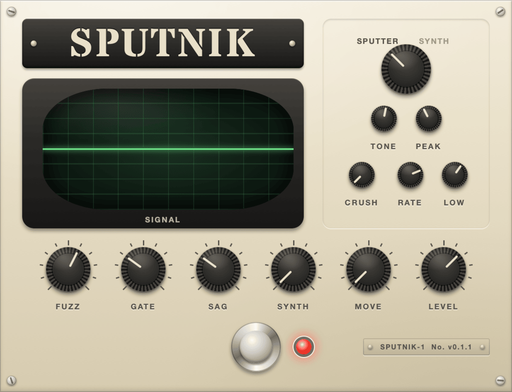

# Sputnik

A sputtering synth fuzz for guitar and bass, with an oscilloscope: a VST3 and CLAP plugin



A digital fuzz for macOS and Windows: a square wave that chokes and
sputters, with an oscillator that follows your playing blended in, and a
phosphor oscilloscope that shows what's coming out.

It has two modes: Sputter, a gated fuzz that stutters in time with your
host, and Synth, a fuzz bass with a filter that opens as you dig in.

## Installing

Download the zip from
[Releases](https://github.com/starzonmyarmz/sputnik/releases) and follow
`INSTALL.txt` inside it.

## Building

```sh
cargo xtask bundle sputnik --release       # target/bundled/Sputnik.{vst3,clap}
scripts/install.sh                         # bundle, sign ad hoc and install on macOS as X.Y.Z-dev+<sha>
scripts/release --dry-run                  # what the next release would be
scripts/clap-validator.sh target/bundled/Sputnik.clap
```

## Tests

`cargo test` runs the engine offline, in host-sized blocks, against
stored golden renders and synthetic checks. After an intended change to
the sound, rerun with `BLESS=1` to rewrite the renders, and listen to
them before committing.

## Working on the UI

The editor is a webview showing `ui/index.html`, which is compiled into
the plugin. Without the plugin, the page runs against a mock, so you can
work on it in a browser:

```sh
cd ui && python3 -m http.server 8765    # open http://127.0.0.1:8765
```

Add `?version=1.2.0` to show a version other than `0.0.0`. To load
the page live in the plugin, set `SPUTNIK_UI_URL` to that URL
before starting the host.

## CI and releases

- `check.yml` runs on pushes to main and on PRs: rustfmt and clippy, the
  tests and clap-validator on macOS, and clap-validator on the Windows
  build. `changelog.yml` checks that a PR with `feat`, `fix` or `perf`
  commits adds lines to `CHANGELOG.md`.
- `scripts/release` releases: it works out the version from the commits
  since the last release (breaking → major, minor before 1.0; `feat` →
  minor; `fix`, `perf`, `revert` → patch), finalizes `CHANGELOG.md`,
  commits, tags `vX.Y.Z` and pushes. Add `--dry-run` to only look.
- `release.yml` runs on that tag. It builds a universal macOS bundle and a
  Windows bundle, validates both, and publishes `sputnik-X.Y.Z.zip` with
  `INSTALL.txt` and `SHA256SUMS`, with the changelog section as the notes.
- Nothing on GitHub takes screenshots. `scripts/release` retakes
  `docs/sputnik.png` through `scripts/pre-release.sh` before the release
  commit, so the shot shows the new version. Between releases, retake it
  with `scripts/screenshot.sh` and commit it with the UI change it shows.

## Built with

- [nice-plug](https://codeberg.org/RustAudio/nice-plug), pinned to
  [a fork](https://github.com/starzonmyarmz/nice-plug/tree/patina) that
  adds `ActivateContext::gui_context()`.
- Set up with
  [project-kit](https://github.com/starzonmyarmz/project-kit).
